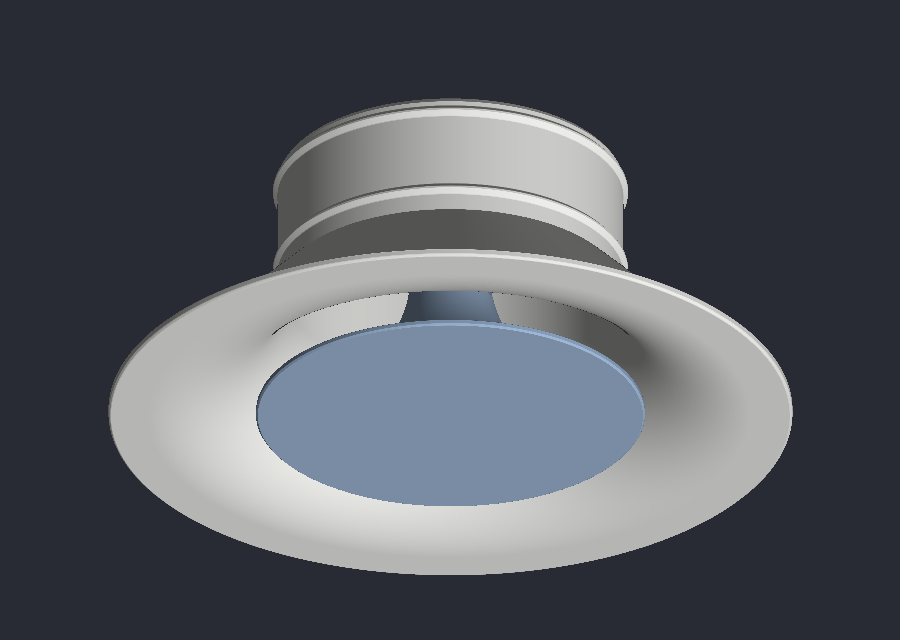
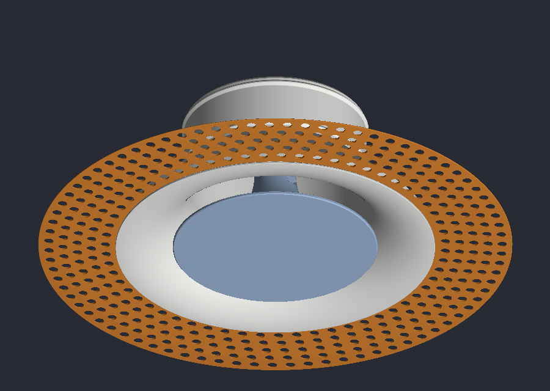
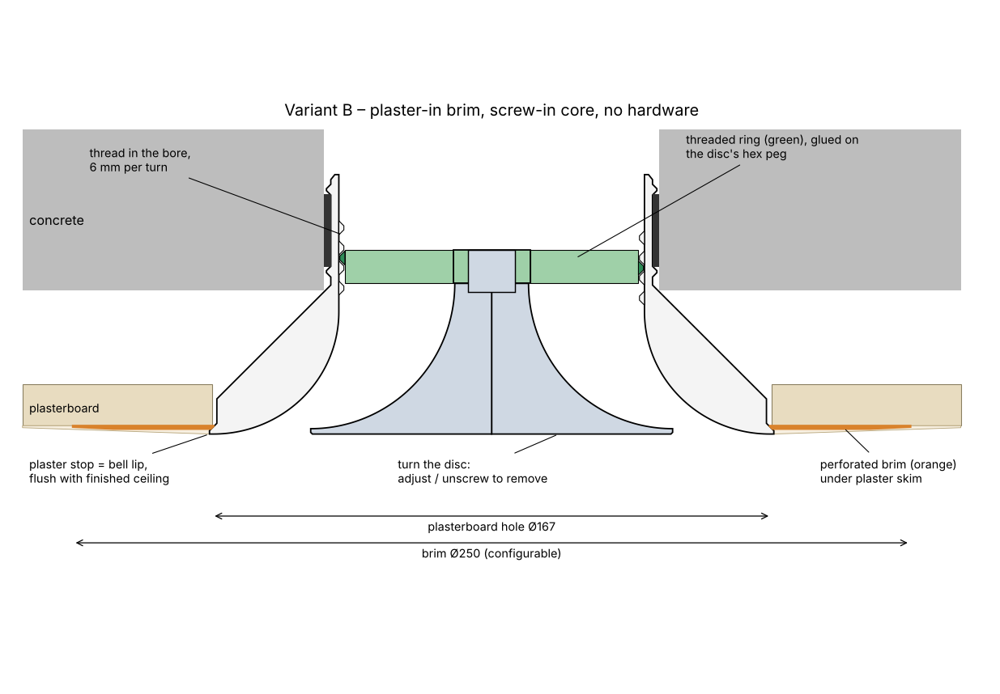

# printable-drywall-coanda-air-vent

I have 100mm air ducts in my concrete ceiling and have lowered it with 28mm furring strips and 12.5mm plasterboard. I have not found a discrete supply air valve that has the coanda effect and that fits 100mm. But I thought I could use the extra 40.5mm extra space below the real ceiling to fit a wider funnel so I asked Claude to design a 3d model of an air vent that I could 3d print and fit into my 100mm air ducts.

**I haven't tested the coanda effect yet.**

Claude has made two models for me, one using an M6×50 fully threaded hex screw and two M6 nuts, and another fully printable. Both require some kind of gasket or self-adhesive EPDM foam strip, about 3 mm thick (default 9–10 mm wide).

Here are some renders of the model without the m6 screw:

